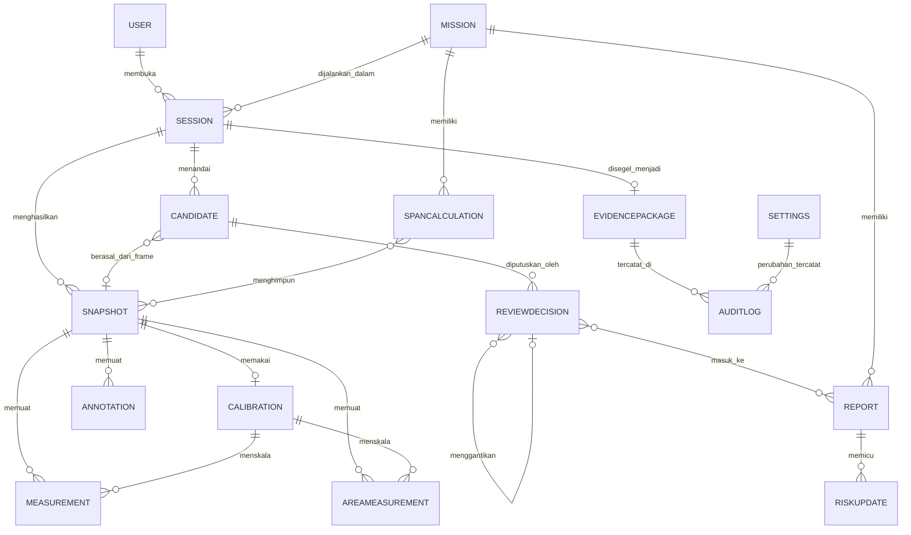

# DATA_MODEL – Entitas DeepInsight

Hasil Fase 0. Model ini diturunkan dari `SPEC_Fungsional.md`, mockup, dan flow map. Tidak ada skema fisik (SQL atau OpenAPI) di sini; format penyimpanan dan teknologi baru diputuskan di Fase 1.

**Cara membaca kolom *Sumber***

- `SPEC` = dinyatakan di SPEC (dengan nama layar).
- `M` = terlihat di mockup (placeholder atau label).
- `†` = disimpulkan agar model utuh; tidak dinyatakan eksplisit. Setiap `†` dicatat di `OPEN_QUESTIONS.md` (kode OQ di kolom *Catatan*).

Satuan memakai yang tertulis di sumber: panjang dalam m, luas dalam m², skala dalam mm/px atau m/px, referensi dalam cm, ketidakpastian dalam cm. Penyeragaman satuan diputuskan di Fase 1 (Q-DAT-2).

## 1. Diagram relasi

## 2. Entitas utama (14)

### 2.1 Session

Satu sesi kerja operator dari Login sampai Penutupan (Optical → “Selesai sesi”).

| Field | Tipe | Sumber | Catatan |
| --- | --- | --- | --- |
| id | string/uuid | † | Q-DAT-1 (skema ID) |
| user_id | ref User | SPEC 0.1 | |
| active_role | enum 6 peran | SPEC 0.2 | Q-ROL-1 |
| rov_device | string | SPEC 0.2, M Peran | “[Nama ROV] · kamera utama” |
| camera_preset | string (terkunci) | SPEC 0.2 | fokus dan eksposur terkunci |
| mission_id | ref Mission | SPEC 3 | |
| mode | enum normal/terbatas | SPEC 0 | terbatas bila GPU tidak ada |
| started_at, ended_at | datetime | † | memakai jam tersinkron (SPEC 0) |
| recording_state | enum REC/PAUSE/STOP | SPEC 3 | |
| signal_state | enum OK/LOST_SIGNAL | SPEC 3 | LOST SIGNAL menonaktifkan FREEZE |
| duration, snapshot_count, stored_size, finding_count | angka | SPEC 12 | kartu ringkasan Penutupan |
| active_feature | enum Optical/AquaClear/HydroDetect/SpatialSight | SPEC “satu window aktif” | Canvas tidak memuat model |
| package_id | ref EvidencePackage | SPEC 12 | |
| upload_status | enum | SPEC 12 | menunggu jaringan |

### 2.2 Mission

| Field | Tipe | Sumber | Catatan |
| --- | --- | --- | --- |
| id | string | † | Q-DAT-1 |
| name | string | M (Sinorang River Crossing) | |
| survey_type | string | M Dashboard/Arsip (“survei free span”) | |
| location | string | SPEC 2 | |
| survey_date | date | SPEC 2 | |
| pipe_diameter_inch | enum 16 / 8 | SPEC 2 | terkunci setelah mulai |
| critical_limit_m | decimal | SPEC 2 | 9,65 untuk 16", 5,32 untuk 8" (otomatis) |
| team | peta peran → user (6) | SPEC 2 | |
| status | enum Direncanakan/Berjalan/Selesai | SPEC 1 | |
| precheck | objek | SPEC 2 | uji batang 1 m ±3%, kalibrasi lensa, preset terkunci, laser menyala, ruang simpan; masing-masing Lolos/Gagal |
| precheck_rod_measured_m, precheck_rod_error_pct | decimal | SPEC 2 | † nilai terukur perlu disimpan; OQ Q-MIS-1 |
| started_at, locked_at | datetime | SPEC 2 | draf dapat diubah sampai dimulai |
| inspection_hours | decimal | SPEC 9 | untuk KPI; † |

### 2.3 Snapshot

Satu frame asli yang dibekukan, dengan JPEG (frame + overlay ukur) dan JSON (titik, skala, ketidakpastian, metadata).

| Field | Tipe | Sumber | Catatan |
| --- | --- | --- | --- |
| id | string | SPEC 3.5.3 (“ID sama untuk JPEG dan JSON”) | format ID: Q-DAT-1 |
| mission_id, session_id | ref | † | |
| frame_id, timecode | string | SPEC 3 | “Frame [ID] · [timecode]” |
| captured_at | datetime | SPEC 3, 0 | jam tersinkron |
| depth_m, heading_deg | decimal | SPEC 3, M Snapshot | kedalaman ada di metadata; heading †|
| aquaclear_preset | string | SPEC 3.1 | dicatat saat FREEZE |
| pipe, segment (S-n) | string | SPEC 3.5, 5 | cara menetapkan segmen: Q-SEG-1 |
| freeze_no | 1 atau 2 | SPEC 3.5 | “freeze 1 dari 2” |
| operator, operator_role | ref User, enum | SPEC 5 | “[waktu] · [operator]” |
| source_frame_path | path | † | frame asli tanpa overlay; Q-DAT-3 |
| jpeg_path, json_path | path | SPEC 3.5.3 | dua berkas, ID sama, tidak dapat ditimpa |
| inspector_note | text | SPEC 3.5.3 | opsional (kondisi lapangan) |
| calibration_id | ref | SPEC 3.5 | |
| status | enum VALID/ESTIMATE_ONLY/UNCALIBRATED/selisih>5 cm | SPEC 5 (kartu Gallery) | status turunan |
| version, supersedes_id | int, ref | SPEC 3.5.3 | koreksi membuat versi baru |
| hash | string | † | Q-DAT-4 |
| deleted | boolean | SPEC 5 | hanya administrator, tercatat |

### 2.4 Calibration

Berlaku untuk satu frame saja; RESUME menghapus kalibrasi (SPEC 3.5).

| Field | Tipe | Sumber | Catatan |
| --- | --- | --- | --- |
| id | string | † | |
| snapshot_id / frame_id | ref | SPEC 3.5 | berlaku satu frame |
| method | enum laser_otomatis (A2) / klik_manual (A1) / canvas_node | SPEC 3.5 | |
| node1, node2 | (x, y) piksel | SPEC 3.4, 3.5 | ruang koordinat frame asli; di mockup 800×500 (Q-CAN-1) |
| reference_length_cm | decimal | SPEC 3.4 | dari Settings (laser) atau input |
| pixel_distance | decimal | SPEC 3.4 | |
| scale | decimal | SPEC 3.4 | m/px = referensi (m) ÷ jarak piksel; tampil mm/px |
| status | enum UNCALIBRATED/ESTIMATE_ONLY/VALID | SPEC 3.5 | ambang uncertainty VALID→ESTIMATE_ONLY ditetapkan tim (Q-KAL-1) |
| source | string | SPEC 3.5.3 | “laser otomatis (A2), dikonfirmasi operator” |
| confirmed_by | ref User | SPEC 3.5 | |
| diameter_check | enum wajar/peringatan, nominal, terukur | SPEC 3.5 | ambang kewajaran: Q-KAL-2 |
| invalidated | boolean | SPEC 3.5 | true setelah RESUME |

### 2.5 Measurement (Distance, Path, Panjang)

| Field | Tipe | Sumber | Catatan |
| --- | --- | --- | --- |
| id | string | † | |
| snapshot_id, calibration_id | ref | SPEC 3.4, 3.5 | |
| kind | enum distance/path/length | SPEC 3.5 (Distance, Path), 3.4 (Panjang) | |
| points | daftar (x, y) | SPEC 3.5 | path = banyak titik; length = 2 node |
| value_m | decimal | SPEC 3.4 | jarak piksel × skala |
| uncertainty_cm | decimal | SPEC 3.5 | metode hitung: Q-KAL-3 |
| label | string | SPEC 3.4 | L1, L2, … |
| depth_edge_risk | boolean | SPEC 3.5 | titik dekat tepi objek; nonaktifkan Simpan |
| status | enum | SPEC 3.5 | mewarisi status kalibrasi |

### 2.6 AreaMeasurement

| Field | Tipe | Sumber | Catatan |
| --- | --- | --- | --- |
| id | string | † | |
| snapshot_id, calibration_id | ref | SPEC 3.4 | |
| point_count | 3 atau 4 | SPEC 3.4 | |
| points | daftar (x, y) | SPEC 3.4 | berurutan mengelilingi bidang |
| side_lengths_m | daftar decimal | SPEC 3.4 | tiap sisi diberi label |
| diagonal_m | decimal | SPEC 3.4 | hanya 4 titik; titik 1–titik 3 |
| area_m2 | decimal | SPEC 3.4 | 3 titik: Heron; 4 titik: dua segitiga Heron dijumlah |
| label | string | SPEC 3.4 | A1, A2, … |
| uncertainty | decimal | † | tidak ditentukan untuk luas |
| depth_edge_risk | boolean | SPEC 3.5 | |
| ai_mask_area_m2, corrected_area_m2, diff_pct | decimal | SPEC 4 | di Review; dipakai luas koreksi |

### 2.7 Annotation

| Field | Tipe | Sumber | Catatan |
| --- | --- | --- | --- |
| id | string | † | |
| snapshot_id | ref | SPEC 3.4 | lapisan terpisah dari frame asli |
| type | enum panah/garis/tanda_bulat | SPEC 3.4 | |
| color | enum merah/kuning/biru/hijau/putih | SPEC 3.4 | |
| point_a, point_b | (x, y) | SPEC 3.4 | tanda bulat: a = pusat, jarak ke b = jari-jari |
| created_by, created_at | ref, datetime | † | |

### 2.8 Candidate

Kandidat temuan: dari HydroDetect, Tandai temuan, Canvas, atau Kalkulator span.

| Field | Tipe | Sumber | Catatan |
| --- | --- | --- | --- |
| id | string | † | |
| source | enum HydroDetect/Kalkulator span/Canvas/Tandai temuan | SPEC 4 | |
| class | enum | SPEC 3.2, M Analisis AI | 7 kelas di filter, 8 di tabel metrik (Q-AI-1) |
| confidence | 0..1 | SPEC 3.2 | |
| mask / polygon AI | geometri | SPEC 4 | format penyimpanan †, Q-AI-2 |
| frame_id, snapshot_id | ref | SPEC 3 | “Tandai temuan” memberi frame saat ini; apakah menyimpan frame: Q-CAN-3 |
| measurement_refs | daftar ref | SPEC 4 | panjang, luas, kalibrasi |
| risk_level | enum Kritis/Sedang/Rendah | SPEC 4 | pemetaan kelas→tingkat: Q-REV-1 |
| review_rule | enum 2_pemeriksa / 1_pemeriksa / shortcut | SPEC 4 | |
| status | enum Menunggu/Terkonfirmasi/Ditolak/Kelas diubah/Ukur ulang | SPEC 4 | “1 dari 2 pemeriksa” adalah status antara |
| created_by, created_at | ref, datetime | SPEC 3 | tercatat di log sesi |
| hidden_by_filter | boolean | SPEC 3.2 | hanya tampilan, data tidak dihapus |

### 2.9 ReviewDecision

| Field | Tipe | Sumber | Catatan |
| --- | --- | --- | --- |
| id | string | † | |
| candidate_id | ref | SPEC 4 | |
| decision | enum konfirmasi/tolak/ubah_kelas/koreksi_ukur/minta_ukur_ulang | SPEC 4 | |
| reason | text (wajib) | SPEC 4 | termasuk penilaian kalibrasi dan ukuran |
| reviewer_id, reviewer_order | ref, 1 atau 2 | SPEC 4 | dua pemeriksa harus berbeda untuk kritis |
| decided_at | datetime | SPEC 4 | |
| supersedes_id | ref ReviewDecision | SPEC 4 | keputusan tak dapat dihapus; perubahan = catatan baru |
| new_class | enum | SPEC 4 | masuk antrian pelatihan ulang |
| corrected_polygon | geometri | SPEC 4 | “poligon koreksi reviewer” |
| verification_checks | daftar 7 butir | SPEC 4 | status kalibrasi, skala, diameter, L, luas mask, luas koreksi + selisih %, DEPTH_EDGE_RISK |
| negative_example | boolean | SPEC 4 | Tolak → contoh negatif untuk Analisis AI |

### 2.10 Report

| Field | Tipe | Sumber | Catatan |
| --- | --- | --- | --- |
| id | string | † | |
| mission_id | ref | SPEC 6 | |
| revision | int | SPEC 6 | revisi membuat versi baru; format nomor: Q-RPT-1 |
| status | enum Draf/Diperiksa/Disetujui | SPEC 6 | tiga langkah |
| steps | daftar {langkah, user, waktu, selesai} | SPEC 6 | Draf, Pemeriksa teknik, Ketua tim |
| summary, recommendation | text | SPEC 6 | dapat disunting sebelum disetujui |
| finding_refs | daftar ref ReviewDecision | SPEC 6 | tabel temuan: temuan, lokasi, bukti, pemeriksa |
| package_hash | string | SPEC 6 | dicetak di kaki laporan |
| locked | boolean | SPEC 6 | terkunci setelah disetujui |
| pdf_path | path | SPEC 6 | Ekspor PDF |

### 2.11 RiskUpdate

| Field | Tipe | Sumber | Catatan |
| --- | --- | --- | --- |
| id | string | † | |
| mission_id / segment | ref | SPEC 7 | |
| matrix_before, matrix_after | (PoF, CoF) 5×5 | SPEC 7 | penanda S dan B (PR-06-019) |
| pof_freespan_pct_of_limit | decimal | SPEC 7 | PR-06-111 |
| mitigation_present | boolean | SPEC 7 | |
| pof_category | enum | SPEC 7 | definisi kategori: Q-RBI-1 |
| loie | enum A–E | SPEC 7 | diusulkan sistem, ditetapkan Pemeriksa teknik (PR-06-117) |
| interval_years | enum 1/2/3 | SPEC 7 | Low 3, Low to Moderate 2, Moderate ke atas 1 |
| set_by, set_at | ref, datetime | SPEC 7 | |

### 2.12 EvidencePackage

| Field | Tipe | Sumber | Catatan |
| --- | --- | --- | --- |
| id | string | † | |
| name, survey_type, date | string | SPEC 10 | |
| session_id / mission_id | ref | SPEC 12 | |
| contents | {snapshot_count, report_count, log_count} | SPEC 10 | |
| manifest | daftar {path, sha256} | SPEC 10 (“hash seluruh berkas”) | struktur manifest dan urutan hash: Q-DAT-4 |
| package_hash | sha256 | SPEC 10, 12 | tampil 8 karakter pertama |
| sealed_at | datetime | SPEC 12 | langkah 3 “Hash dibuat” |
| upload_status, upload_progress | enum, % | SPEC 12 | auto-retry saat online |
| integrity_status | enum Utuh/Perlu cek ulang | SPEC 10 | dihitung ulang saat dibuka |
| immutable | boolean | SPEC 10 | hanya baca |

### 2.13 AuditLog

| Field | Tipe | Sumber | Catatan |
| --- | --- | --- | --- |
| id | string | † | |
| at | datetime | SPEC 0.1, 11 | |
| user_id, role | ref | SPEC 0.1, 11 | |
| session_id | ref | † | |
| action | enum/string | SPEC | login gagal, penguncian, FREEZE, Tandai temuan, perubahan Settings, penghapusan snapshot, kejadian performa, cek integritas, keputusan Review |
| entity, entity_id | string | † | |
| old_value, new_value | json | SPEC 11 | perubahan Pengaturan |
| note | text | † | |

Dibedakan dari log sesi (kejadian operasional di SPEC 3 dan 3.9). Apakah keduanya satu penyimpanan: Q-DAT-5. Bukti tidak boleh diubah: Q-DAT-5.

### 2.14 Settings

| Kelompok | Field | Nilai/contoh | Sumber |
| --- | --- | --- | --- |
| Alat referensi | laser_distance_cm, rod_length_m | batang 1,00 m | SPEC 11 |
| Ambang | rod_tolerance_pct 3; freeze_delta_cm 5; rope_tolerance_pct 2 | | SPEC 11 |
| Batas kritis | critical_limit_16in_m 9,65; critical_limit_8in_m 5,32 | | SPEC 11 |
| Ambang tim (belum ditetapkan) | diameter_plausibility_pct; login_max_attempts; login_lock_minutes; fps_threshold; gpu_threshold; uncertainty_threshold_estimate_only | kosong | SPEC “Hal yang masih perlu ditetapkan” |
| Preset | aquaclear_presets {Inspection, Balanced, Ringan}; camera_presets | | SPEC 11 |
| Model | active_model | exp-5 | SPEC 11, M |
| Pengguna dan peran | users[{nama, peran[]}] | | SPEC 11 |
| Kontroler ROV | button_map | usulan: Spasi/A untuk FREEZE, LB/RB ganti fitur | SPEC (belum ditetapkan) |
| Meta | updated_by, updated_at | | SPEC 11 (via AuditLog) |

## 3. Entitas pendukung (diturunkan, di luar daftar 14)

Entitas ini diperlukan agar relasi di atas terdefinisi. Tidak ada di daftar prompt dan perlu persetujuan sebelum dipakai di Fase 1.

| Entitas | Tujuan | Field utama | Sumber |
| --- | --- | --- | --- |
| User | identitas dan peran | id, nama, credential (SSO/PIN ter-hash), roles[], locked_until | SPEC 0.1, 0.2, 11 |
| SpanCalculation | hasil Kalkulator span per pipa dan survei | mission_id, pipe, segments[{S, freeze1_m, freeze2_m, delta_cm, calibration_status, ok}], L_left, L_right, L_total, rope_length_m, rope_diff_pct, rod_evening_error_pct, limit_pct, recommendation (FEA / survei ulang 6 bulan), survey_no | SPEC 5.2 |
| ModelVersion | siklus model | name (exp-5, exp-4), status aktif/diarsip, metrik per kelas, dataset, released_at | SPEC 8 |
| Segment/Pipe | definisi pipa dan segmen S1–S6, P0, G kiri/kanan, titik tengah, PE+2 | pipe_id, diameter, station | SPEC 3, 5.2 (cara pembentukan: Q-SEG-1) |

## 4. Invarian yang harus dijaga data

1. Frame asli tidak pernah berubah; overlay, anotasi, dan ukuran disimpan sebagai lapisan terpisah (SPEC 3, 3.4).
2. Kalibrasi dan titik ukur menempel pada satu frame (`frame_id`); RESUME menghapus kalibrasi yang belum disimpan (SPEC 3.5).
3. JPEG dan JSON snapshot memakai ID yang sama dan tidak dapat ditimpa; koreksi membuat versi baru (SPEC 3.5.3).
4. Keputusan Review tidak dapat dihapus; perubahan keputusan membuat catatan baru yang merujuk catatan lama (SPEC 4).
5. Temuan kritis butuh dua `reviewer_id` yang berbeda (SPEC 0.2, 4).
6. Ukuran berstatus UNCALIBRATED tidak dapat dikonfirmasi; hasil berstatus DEPTH_EDGE_RISK tidak boleh dipakai di Kalkulator span (SPEC 3.4, 4).
7. Laporan yang disetujui terkunci; revisi membuat versi baru (SPEC 6).
8. Paket arsip hanya baca; integritas dicek dengan hash ulang (SPEC 10).
9. Perubahan Settings dicatat dengan nilai lama dan baru; perubahan ambang tidak mengubah misi yang sudah ditutup (SPEC 11). Maka nilai ambang yang berlaku harus tersimpan pada misi (snapshot Settings per misi): Q-DAT-6.
10. Setelah misi dimulai, diameter pipa dan batas kritis terkunci (SPEC 2).
