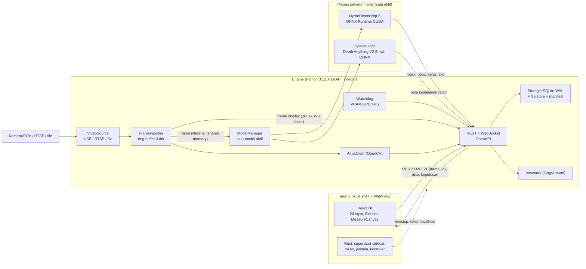
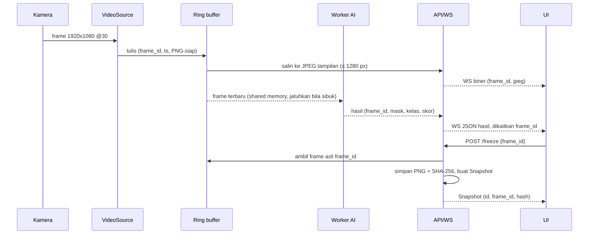
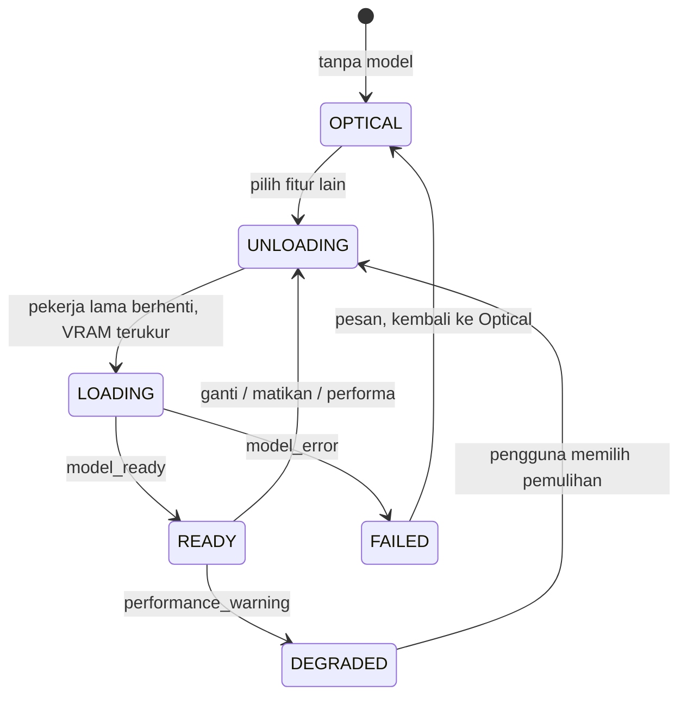
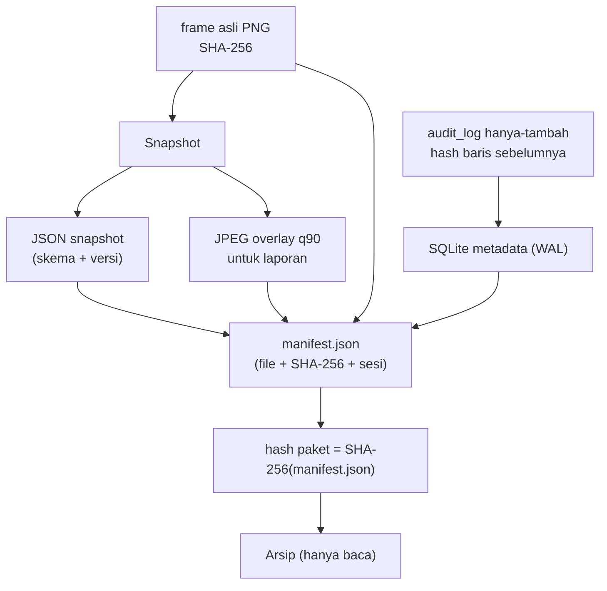
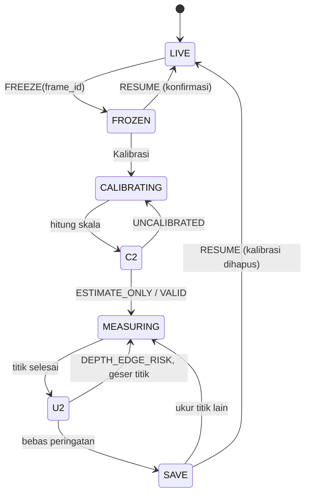

# ARCHITECTURE – DeepInsight (desktop, Windows, offline-first)

Status: **diusulkan** untuk persetujuan. Dasar: `SPEC_Fungsional.md`, `STUDY_NOTES.md`, `NAVIGATION_MAP.md`, `DATA_MODEL.md`, dan `ANSWERS_OPEN_QUESTIONS.md`. Urutan prioritas sumber **[J]**: `ANSWERS_OPEN_QUESTIONS.md` dan `DECISIONS.md` mengalahkan `.cursor/rules/deepinsight.mdc`, yang mengalahkan SPEC, yang mengalahkan mockup. Bila ada konflik, yang lebih tinggi menang dan file di bawahnya diperbarui.

Tanda **[J]** = angka atau perilaku dari `ANSWERS_OPEN_QUESTIONS.md`. Tanda **[T]** = target rancangan saya (belum diukur; diverifikasi di Fase 2 dan 10).

## 1. Tujuan arsitektur

| Prioritas | Tujuan | Konsekuensi desain |
| --- | --- | --- |
| 1 | **Bukti tidak boleh rusak.** Frame asli, kalibrasi, dan ukuran harus dapat dibuktikan berasal dari satu frame dan tidak berubah | UI tidak pernah mengirim piksel sebagai bukti; engine menyimpan frame dari ring buffer berdasarkan `frame_id`; PNG lossless + SHA-256; audit log berantai hash |
| 2 | **FREEZE selalu responsif**, walau AI berat | Jalur FREEZE tidak melewati model AI; AI berjalan di proses terpisah dan boleh menjatuhkan frame |
| 3 | **VRAM kembali bersih** setiap ganti fitur | Satu model aktif; setiap model berjalan di proses pekerja yang dapat dimatikan (jaminan pelepasan VRAM) |
| 4 | **Angka dapat diperiksa ulang** | Fungsi ukur murni, satu spesifikasi, dua implementasi (Python dan TypeScript) diuji dengan vektor emas yang sama |
| 5 | **Mudah di-troubleshoot** | Kode error terdaftar, log JSON per sesi dengan `session_id`, `/diagnostics` |
| 6 | **Semua ambang di config** | Tidak ada angka di kode; ambang disalin ke Mission saat misi dimulai |

## 2. Gambaran sistem



Prinsip batas:

1. **Engine memiliki semua data dan komputasi bukti.** UI adalah klien tipis berbasis tipe dari OpenAPI.
2. **Kanal video dan kanal bukti terpisah.** UI menerima JPEG ber-resolusi tampilan untuk ditonton. Bukti selalu diambil engine dari ring buffer pada resolusi penuh.
3. **Overlay hanya di UI.** Laser, kotak bantu, mask AI, node ukur, dan anotasi digambar sebagai lapisan canvas di atas video. Video asli tidak pernah diubah.

## 3. Struktur monorepo (Fase 1)

```text
apps/desktop/            Tauri 2 + React + TS + Vite + Tailwind + React Router
  src/screens/           satu komponen per layar (kode layar di nama berkas)
  src/components/        Sidebar, Header, StatusBadge, MeasureCanvas, dialog bersama
  src-tauri/             Rust: supervisor engine, token, kontroler (gamepad)
services/engine/
  api/                   FastAPI router, skema pydantic, OpenAPI
  video/                 VideoSource (usb, rtsp, file), FramePipeline
  gpu/                   ModelManager, worker, Watchdog, CacheManager
  models/                adapter hydrodetect, spatialsight, aquaclear
  measure/               kalibrasi, panjang, luas, gerbang, span (murni)
  storage/               SQLite, file store, manifest, audit chain
  core/                  config, logging, error codes, ids
packages/shared/         tipe dari OpenAPI + measure TS (cerminan)
config/                  app.yaml, thresholds.yaml, roles.yaml, controls.yaml,
                         hydrodetect.yaml, aquaclear_presets.yaml, risk.yaml,
                         risk_classes.yaml, sustainability.yaml, cameras/<id>.yaml
models/                  hydrodetect/exp5/{model.pt,model.onnx,classes.json,metadata.json}
                         (di luar Git: LFS atau unduhan)
docs/  reference/  tests/golden/
```

`measure/` tidak boleh mengimpor FastAPI, SQLite, atau model. Satu-satunya dependensi: `math` dan tipe data. Ini menjamin uji unit cepat dan hasil identik dengan cerminan TypeScript.

## 4. Alur data video → engine → UI



Aturan alur:

- **Kunci kebenaran = `frame_id`.** UI mengirim `frame_id` yang sedang tampil, bukan piksel. Bila frame sudah keluar dari ring buffer (> 3 dtk, **[J]** Q-VID-1), engine menolak dengan kode error; FREEZE normal tidak mungkin sampai ke kondisi itu.
- **Hasil AI membawa `frame_id`.** UI hanya menggambar overlay AI bila `frame_id` hasil cukup dekat dengan frame tampil (jendela di config); di mode FROZEN hasil dihitung ulang pada frame beku.
- **LOST SIGNAL** = tidak ada frame baru > 2 dtk **[J]**. Engine mengirim event, UI membekukan tampilan dan menonaktifkan FREEZE.
- **Resolusi:** sumber bawaan 1920×1080 @ 30 fps **[J]**. Pengukuran selalu dalam piksel frame asli (Q-CAN-1 **[J]**).
- **Dua kecepatan:** tampilan mengejar fps sumber; inferensi berjalan sebisanya. FPS yang dilaporkan Watchdog adalah fps tampilan dan fps inferensi secara terpisah.

## 5. Siklus hidup model AI di GPU



Urutan **ganti fitur** (dialog 3.0, SPEC):

1. UI mengirim `switch(name)`; ModelManager mengantre (satu permintaan aktif; yang lain menunggu atau dibatalkan oleh Batal).
2. **Stop inferensi**: berhenti mengirim frame ke pekerja.
3. **Matikan pekerja model lama.** Berhenti lunak (tutup sesi ORT, `gc.collect()`), lalu bila VRAM belum kembali ke garis dasar dalam batas waktu config, **hentikan proses** (jaminan pelepasan driver).
4. **Ukur VRAM** sebelum dan sesudah (`nvml`), catat di log sesi.
5. **Mulai pekerja baru** dan muat model; kirim `model_ready` atau `model_error`.
6. Video asli tetap berjalan selama langkah 1–5 (SPEC 3.0).

Alasan proses-per-model: PyTorch/ORT sering menahan memori di cache allocator/arena walau `empty_cache()` dipanggil. Mematikan proses adalah satu-satunya cara yang menjamin VRAM kembali. Biayanya: waktu mulai pekerja dan transfer frame lewat shared memory. Lihat ADR-004.

**Mode terbatas** (tanpa GPU **[J]** Q-GPU-3): AquaClear di CPU (OpenCV); HydroDetect dan SpatialSight nonaktif di UI dengan alasan.

**Watchdog (tiap 2 dtk, [J] ambang Q-GPU-1)**: `performance_warning` bila FPS < 15 selama 5 dtk, atau VRAM > 85%, atau utilisasi GPU > 95% selama 10 dtk. Event memicu dialog 3.9; pilihan pemulihan = matikan fitur atau preset AquaClear ringan.

## 6. Pengukuran (modul `measure/`)

Satu spesifikasi, dua implementasi, satu set vektor emas (`tests/golden/measure_vectors.json`, dibuat di Fase 0b dari referensi Python). Hasil Python dan TypeScript harus sama pada toleransi 1e-9 relatif.

| Fungsi | Definisi |
| --- | --- |
| Undistort node | Titik yang diklik (piksel frame asli) di-undistort dengan `config/cameras/<id>.yaml` (model pinhole OpenCV: fx, fy, cx, cy, k1 k2 p1 p2 k3) **sebelum** jarak dihitung. Hanya koordinat node yang dikoreksi; gambar bukti tetap asli **[J]** |
| Skala | `s = L_ref_m / jarak_px(u(node1), u(node2))`, `u` = undistort |
| Panjang | `L = s · jarak_px(u(a), u(b))` |
| Ketidakpastian skala | `σs/s = √2 · σp / jarak_ref_px` (σp = 1,5 px **[J]**) |
| Ketidakpastian panjang | `σL = √[(L·σs/s)² + 2·(s·σp)²]`; ditampilkan sebagai ±2σ **[J]** |
| Status kalibrasi | relatif = **2σL/L (±2σ, angka yang tampil di layar)** ≤ 3% VALID; 3–10% ESTIMATE_ONLY; > 10% atau gagal UNCALIBRATED **[J]**. **Tanpa file kalibrasi kamera, status maksimal ESTIMATE_ONLY** **[J]** |
| Luas | **shoelace** pada koordinat terkalibrasi (benar untuk cembung dan cekung) **[J]**; Heron sebagai cek silang untuk 3 titik |
| Validasi poligon | titik berbeda; tanpa perpotongan sendiri (“Urutan titik bersilangan, klik ulang searah keliling”); luas > 0 (“Titik segaris, luas nol”) |
| DEPTH_EDGE_RISK v1 | jarak titik ke tepi Canny terdekat < 5 px **[J]** |
| Cek kewajaran diameter | peringatan bila diameter terukur menyimpang > 10% dari OD nominal (16" = 406,4 mm; 8" = 219,1 mm); tidak memblokir **[J]** |
| Segmen | pasangan freeze terakhir yang lolos; selisih ≤ 5 cm; L-total vs tali ≤ 2%; uji batang ±3% |
| Span | L-kiri, L-kanan dari G kiri; titik tengah = L-total/2, segmen terpotong dihitung proporsional **[J]**; peringatan di ≥ 80% batas kritis |

**Temuan penting dari verifikasi vektor.** Metode luas 4 titik pada mockup (Heron dua segitiga dengan diagonal titik 1–titik 3) memberi hasil salah bila diagonal itu jatuh di luar bidang. Pada vektor `segiempat_diagonal_1_3_di_luar`, luas sebenarnya 4,0 m² dan metode mockup menghasilkan 12,0 m². Keputusan memakai shoelace (Q-CAN-2) menghilangkan kesalahan ini.

**Ambang berlaku pada ±2σ [J].** Angka yang tampil di layar adalah angka yang dinilai operator dan reviewer, jadi gerbang status memakai angka yang sama (`calibration.rel_uncertainty_basis: 2sigma`). Komponen kedalaman diabaikan pada v1 dan dicatat sebagai keterbatasan **[J]**.

**Distorsi lensa [J].** Pada vektor `undistort_node_opencv_pinhole` (distorsi contoh yang sengaja besar), panjang tanpa undistort 3,488 m dan dengan undistort 3,212 m: selisih ±8,6%. Angka ini hanya menunjukkan bahwa koreksi dapat mengubah hasil secara berarti pada lensa lebar; selisih nyata bergantung pada lensa dan posisi node di frame. File kamera yang hilang atau tidak cocok dengan kamera terpilih membatasi status ke ESTIMATE_ONLY dan memunculkan peringatan di pre-check Misi dan Mode Snapshot.

## 7. Penyimpanan, integritas, dan audit



- **Lokasi**: `%LOCALAPPDATA%/DeepInsight/` berisi `db/`, `sessions/<SES-id>/` (PNG, JPEG, JSON, log), `cache/`, `packages/`, `reference/`. Perubahan lokasi lewat Pengaturan.
- **ID**: tampilan berformat (`MSN-YYYYMMDD-NN`, `SES-YYYYMMDD-HHMM`, `SNP-<sesi>-NNNN`, `CND-<sesi>-NNNN`), internal UUIDv7 **[J]**.
- **Tidak dapat ditimpa**: JPEG dan JSON berbagi ID; koreksi membuat versi baru yang menunjuk `supersedes_id`. File dibuat dengan mode tulis-sekali, dan integritas dibuktikan oleh hash di manifest.
- **Audit log** (SQLite, hanya-tambah): setiap baris menyimpan hash baris sebelumnya; pemeriksaan rantai menjadi bagian dari cek integritas Arsip. **Log operasional** terpisah: JSON berotasi per sesi.
- **Cache** (`CacheManager`): batas ukuran LRU dari config; `clear_session()` saat Penutupan; bukti tidak pernah di cache.
- **Unggah v1**: salin paket ke folder jaringan atau USB yang dipilih di Pengaturan; tanpa server **[J]**. Status antrian tampil di Arsip.
- **Keamanan**: engine hanya mendengarkan `127.0.0.1` dengan token acak per peluncuran yang diteruskan Rust ke UI; PIN di-hash Argon2id **[J]**; SSO tampil nonaktif “Segera”.

## 8. Mesin status utama

**Alur FREEZE → ukur → simpan** (satu frame):



**Review** (kandidat): `Menunggu → (Pemeriksa 1) → [kritis] 1 dari 2 → (Pemeriksa 2, akun berbeda) → Terkonfirmasi`; bila pemeriksa 2 berbeda keputusan → **Sengketa** → keputusan Ketua tim dengan alasan wajib **[J]**. Cabang lain: `Ditolak` (contoh negatif), `Kelas diubah` (antrian latih ulang), `Menunggu ukur ulang`.

**Laporan**: `Draf → Diperiksa → Disetujui (terkunci)`; revisi membuat `R<n+1>`; satu akun tidak mengisi dua tahap berturut-turut **[J]**.

**Sesi**: `Splash → Login → Peran → Aktif → Penutupan(1 hentikan rekaman, 2 susun paket, 3 hash, 4 salin) → Selesai`. Tombol Keluar aktif setelah hash dibuat.

## 9. Anggaran performa dan ketahanan [T]

| Metrik | Target | Cara ukur |
| --- | --- | --- |
| FREEZE → Mode Snapshot tampil | ≤ 150 ms | uji otomatis dengan sumber file |
| Ganti model (unload+load) | ≤ 8 dtk, VRAM kembali ke garis dasar ± 150 MB | uji 50× berturut-turut (Fase 2) |
| Tampilan video | ≥ 30 fps pada 1280 px tanpa model; ≥ 24 fps dengan HydroDetect | Watchdog |
| Memori engine setelah 200 FREEZE | tidak tumbuh > 5% | profil sesi 30 menit (Fase 10) |
| Waktu buka aplikasi sampai Splash | ≤ 5 dtk | Fase 10 |
| Ukuran installer | dicatat | Fase 10 |

Mode gagal yang dirancang: sumber video putus (LOST SIGNAL), model gagal dimuat (kembali ke Optical), GPU hilang di tengah sesi (turun ke mode terbatas), disk penuh (blok FREEZE dengan pesan, bukan crash), proses engine mati (Rust memulai ulang dan melanjutkan sesi dari SQLite), PIN salah berulang (kunci 15 menit **[J]**).

## 10. Logging dan diagnostik

- **Log JSON per sesi** (`level, ts, session_id, component, code, msg, ctx`), rotasi, tanpa PIN dan tanpa data bukti.
- **Kode error** terdaftar di `docs/ERROR_CODES.md` (prefiks `VID-`, `GPU-`, `MSR-`, `STO-`, `AUTH-`, `API-`), setiap pesan UI menunjukkan kode.
- **`GET /health`**: hidup. **`GET /diagnostics`**: versi aplikasi/model, GPU (nama, VRAM total/terpakai), model aktif, fps tampilan dan inferensi, ukuran cache, ruang disk, status sinkronisasi jam, kamera, ukuran ring buffer, jumlah pekerja, 20 error terakhir.
- **Penyimpanan diagnostik** dapat diekspor satu klik untuk Teknisi program.

## 11. Pengujian

| Tingkat | Isi |
| --- | --- |
| Unit | `measure/` (vektor emas, kasus batas), parser config, rantai hash audit, ID |
| Kontrak | OpenAPI → tipe TS; tes bahwa UI dan engine sepakat skema |
| Integrasi | ModelManager (50× ganti, VRAM), ring buffer tidak tumbuh, cache tidak melewati batas, FREEZE saat model sibuk |
| UI | vitest untuk MeasureCanvas (transformasi layar ↔ frame asli), Sidebar per peran (matriks `roles.yaml`) |
| E2E | skrip skenario free span dari file video uji: Fase K → ukur S1–S6 → Kalkulator span → Review → Laporan → Arsip |
| Kepatuhan | tabel `COMPLIANCE.md` per layar terhadap SPEC dan NAVIGATION_MAP (Fase 10) |

## 12. Risiko dan mitigasi

| Risiko | Dampak | Mitigasi |
| --- | --- | --- |
| VRAM tidak kembali setelah unload | OOM saat ganti fitur | proses-per-model; ADR-004 |
| Mockup memakai ruang koordinat 800×500 | ukuran salah bila dipindah apa adanya | node selalu piksel frame asli; transformasi di MeasureCanvas |
| Metode luas diagonal pada mockup | luas salah (contoh 12,0 vs 4,0) | shoelace + validasi poligon |
| Frame tampil ≠ frame yang disimpan | bukti tidak sah | FREEZE berdasarkan `frame_id` dari engine |
| Kalibrasi kamera tidak ada atau tidak cocok | ukuran bias di tepi frame | status maksimal ESTIMATE_ONLY; peringatan di pre-check |
| Sumber desain hanya sebagian (prosedur, workbook) | layar 7 dan 9 tampil “–” | stub dan config; TIM mengisi |
| Depth Anything V2 Small (relatif) | tidak dipakai sebagai ukuran | label “Preview relatif, bukan ukuran”; angka tidak pernah diambil dari layar ini |
| Packaging sidecar Python di Windows | ukuran installer besar | PyInstaller/embedded + uji di Fase 10 |
